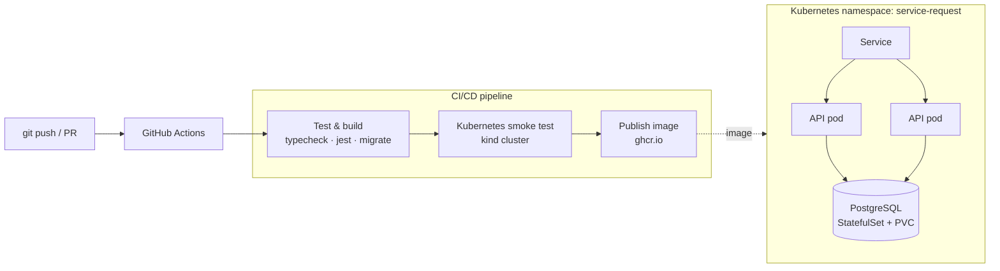

# Service Request API


A small **NestJS + Prisma + PostgreSQL** REST API for submitting and tracking service requests, built as a hands-on project for **Docker**, **CI/CD with GitHub Actions** and **Kubernetes**.

The application is intentionally simple. The focus is on how it is packaged, tested, delivered and run.

## Tech stack

| Area | Tools |
| --- | --- |
| Backend | Node.js 22, NestJS 11, TypeScript |
| Database | PostgreSQL 16, Prisma ORM (migrations, indexes) |
| Validation | class-validator DTOs, Joi environment validation (fail fast at startup) |
| Testing | Jest unit tests |
| Containers | Docker multi-stage build, Docker Compose |
| CI/CD | GitHub Actions, GitHub Container Registry (GHCR) |
| Orchestration | Kubernetes (Deployment, StatefulSet, Service, ConfigMap, Secret, probes), Kustomize, kind |

## Architecture



## API

| Method | Path | Description |
| --- | --- | --- |
| `POST` | `/service-requests` | Create a request (`citizenId` must be 13 digits) |
| `GET` | `/service-requests?officeCode=&status=&limit=` | List active requests, newest first |
| `GET` | `/service-requests/:id` | Get one request |
| `PATCH` | `/service-requests/:id/status` | Set status to `PENDING`, `APPROVED` or `REJECTED` |
| `DELETE` | `/service-requests/:id` | Soft delete |
| `GET` | `/health/live` | Liveness probe (process is up) |
| `GET` | `/health/ready` | Readiness probe (database reachable) |

## Run it

### 1. Docker Compose (quickest)

```bash
docker compose up --build
```

Compose starts PostgreSQL, runs a one-shot `migrate` container (`prisma migrate deploy`), and starts the API only after migrations succeed.

```bash
curl -X POST http://localhost:3000/service-requests \
  -H 'Content-Type: application/json' \
  -d '{"citizenId":"1234567890123","officeCode":"BKK01"}'

curl "http://localhost:3000/service-requests?officeCode=BKK01"
```

### 2. Kubernetes on a local kind cluster

Requires [kind](https://kind.sigs.k8s.io/) and `kubectl`.

```bash
kind create cluster --name dev
docker build -t service-request-api:local .
kind load docker-image service-request-api:local --name dev

kubectl apply -k k8s
kubectl -n service-request rollout status deployment/service-request-api

kubectl -n service-request port-forward svc/service-request-api 8080:80
curl http://localhost:8080/health/ready
```

Clean up with `kind delete cluster --name dev`.

### 3. Local development

```bash
cp .env.example .env
docker compose up -d db
npm ci
npx prisma migrate deploy
npm run start:dev
```

## CI/CD pipeline

Defined in [`.github/workflows/ci-cd.yml`](.github/workflows/ci-cd.yml). It runs on every pull request and on pushes to `main`.

1. **Test & build**: installs dependencies, generates the Prisma client, applies migrations to a real PostgreSQL service container, then runs type-checking, unit tests and the production build.
2. **Kubernetes smoke test**: builds the Docker image, creates a throwaway kind cluster, deploys the manifests in `k8s/`, waits for the rollout, and calls the API through the Kubernetes Service. Pod details and logs are printed if anything fails.
3. **Publish** (`main` only): builds the image with layer caching and pushes it to GHCR tagged with the commit SHA and `latest`.

## Design notes

- **Multi-stage Dockerfile**: dependencies and the build happen in one stage, and only the runtime files are copied into the final image. Copying `package*.json` before the source keeps `npm ci` cached between builds. The container runs as the unprivileged `node` user.
- **Migrations are a separate step**, never part of app startup: a one-shot container in Compose and an `initContainer` in Kubernetes. Two API replicas therefore never race to migrate the same database.
- **Liveness vs readiness**: liveness only checks the process, so a database outage does not cause restart loops. Readiness checks the database, so Kubernetes stops sending traffic to pods that cannot serve it.
- **Zero-downtime rollouts**: `maxUnavailable: 0` with readiness probes keeps old pods serving until new ones are ready.
- **Graceful shutdown**: `enableShutdownHooks()` closes database connections when Kubernetes sends `SIGTERM`.
- **Fail-fast config**: Joi validates environment variables at startup, so a missing `DATABASE_URL` stops the app immediately with a clear error.
- **Indexes follow the queries**: the composite index `(office_code, status, created_at DESC)` matches the list endpoint's filter and sort order.
- **Secrets**: `k8s/secret.yaml` holds demo values for a local cluster only. Real credentials belong in an external secret store.

## Project structure

```
.
├── .github/workflows/ci-cd.yml   # CI/CD pipeline
├── k8s/                          # Kubernetes manifests (kubectl apply -k k8s)
├── prisma/                       # Schema and migrations
├── src/
│   ├── health/                   # Liveness and readiness endpoints
│   ├── prisma/                   # PrismaService (connection lifecycle)
│   ├── service-requests/         # Controller, service, DTOs, tests
│   └── config.validation.ts      # Joi environment schema
├── Dockerfile
└── docker-compose.yml
```
